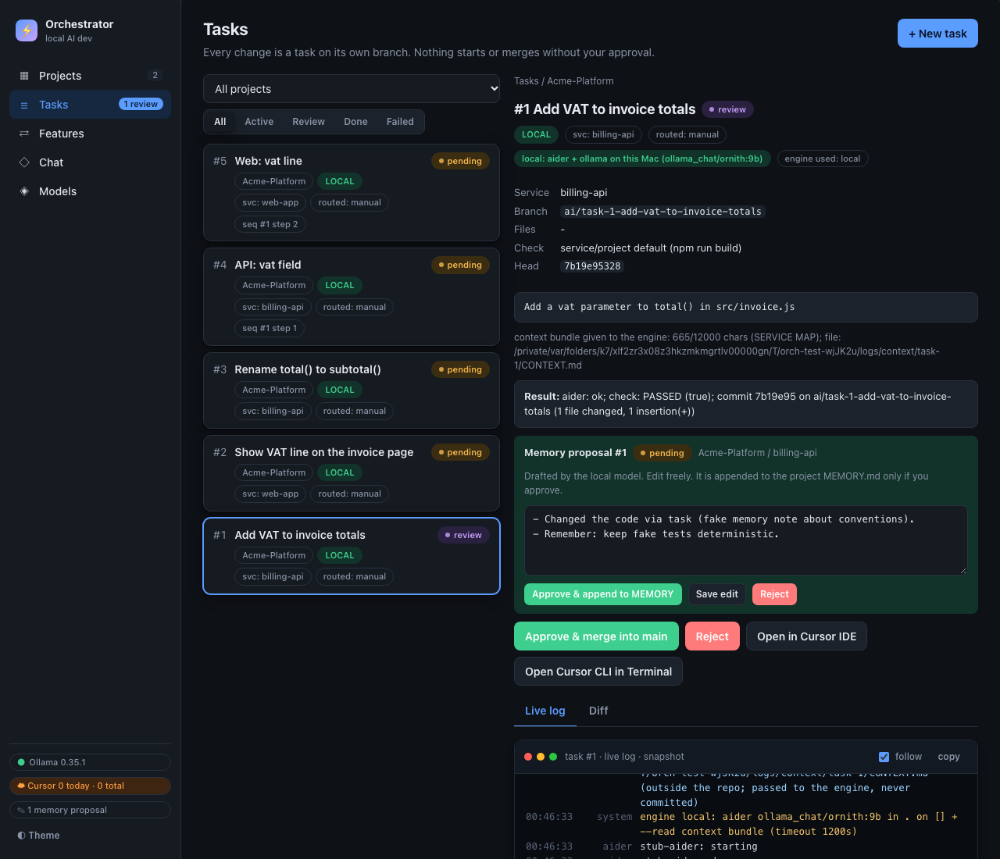

# Local AI Dev Orchestrator

A local-first, human-approved task runner for AI coding agents. You describe a change, approve it, and the orchestrator
makes an isolated **git worktree + branch**, runs an engine (a free local model through **aider + Ollama**, or the
**Cursor CLI**), runs your check command, commits the result on the branch and then **stops for your review**.
**Nothing is ever merged without your explicit approve-merge click.** Everything runs on `127.0.0.1` only.

- Projects contain services (one git repo or a folder in a repo each); every task runs in exactly one service.
- Engines per task: `local` (aider + Ollama, free), `cursor` (Cursor CLI, uses your Cursor plan, needs your approval; runs are counted, not capped) or `auto` (local first, escalate to Cursor only after you approve).
- Shared project rules and memory, a local router that suggests the service/engine, plan-first for complex tasks, sequences across services, an advisory AI review, and "Open in Cursor".
- A read-only **chat** with your local model with `@project` / `@service` mentions, optional **Cursor rules** (`.cursor/rules/*.mdc`) generated per service onto a review branch, and **cross-repo features** (provider service first, contract shared with the consumers, merge-order guard).
- Zero npm dependencies: Node.js + a static dashboard (no build step). Models are never downloaded unless you switch that on.



## Quick start (about 5 minutes)

```bash
git clone https://github.com/OmkarArote/Orchestrator-local-AI-dev.git
cd Orchestrator-local-AI-dev
./setup.sh          # checks prerequisites, creates .env, tells you what is missing (installs nothing)
./start.sh          # dashboard at http://127.0.0.1:4310
```

Then open the dashboard: **Models** (pick one of your installed Ollama models), **Projects** -> New project -> add an existing repo or create a new one, then **New task**.
Stop with `./stop.sh`. If port 4310 is taken, start with another one: `ORCH_PORT=4311 ./start.sh`. On Windows use WSL (the scripts are bash).

No `npm install` is needed (there are no npm dependencies; `npm test` and `./start.sh` run on a fresh clone with just Node >= 22.5 and git).

### Requirements

| Needed for | Requirement | Install |
|---|---|---|
| Everything | **Node.js >= 22.5** (uses the built-in `node:sqlite`) | https://nodejs.org or `nvm install 22` |
| Everything | **git** | https://git-scm.com |
| `local` engine | **Ollama** running, with at least one model | https://ollama.com/download, then e.g. `ollama pull qwen2.5-coder:7b` (about 4.7 GB; fits 16 GB RAM) |
| `local` engine | **aider** | `./setup.sh --install-aider` (or `python3 -m pip install aider-install && aider-install`) |
| `cursor` / `auto` engine (optional) | **Cursor CLI** (`agent`), logged in | `curl https://cursor.com/install -fsS \| bash`, then `agent login` |
| "Open in Cursor" (optional) | Cursor IDE, macOS for the Terminal option | https://cursor.com |

Tested on macOS (Apple Silicon, 16 GB). Linux should work except the macOS-only "open in Terminal" helper. The `local` engine works best with small, precise tasks; use `cursor`/`auto` for larger changes.

Model choice: set `ORCH_MODEL=ollama_chat/<your-model>` in `.env` (default `ollama_chat/qwen2.5-coder:7b`) and/or assign models to roles on the Models page.
Model downloads from the dashboard are **off by default**; enable with `ORCH_ALLOW_MODEL_PULL=1` in `.env` (each download still needs your confirmation).

### Configuration

Copy `.env.example` to `.env` (git-ignored; `setup.sh` does it for you). Real environment variables win over `.env`. The full list of `ORCH_*` settings is in the Configuration section below.
Defaults: repos may live under `~/work` (more folders can be authorized in the UI), worktrees and logs go to `~/work/local-ai-dev/`, the database is `data/orchestrator.db` inside this folder.

### Safety model

Localhost-only (Host/Origin checks, no auth, so do not expose the port), authorized folders only (symlink-safe), hardened git (no hooks, https/ssh only, no credentials stored), hard timeouts and process-group kills on every subprocess, worktree isolation, human approval for start/merge/escalation, Cursor usage counted (there is no cap; Cursor only ever runs after your click), and no automatic merging. Do not put secrets in task prompts: prompts are stored in the local database, shown in logs and, for Cursor tasks, sent to Cursor.

### Development

```bash
npm test            # 418 tests on the author machine (418 pass, 0 fail, 0 skipped; same with CI=1); fresh-clone/CI count is recorded after the pull-request run (the migration tests that need a private DB backup, and the live-Ollama test, skip), no network, no Ollama or Cursor needed (stubs/fakes)
npm run doctor      # same as ./setup.sh
```

Continuing development in another tool (e.g. Cursor)? Start with `docs/HANDOFF-CURSOR.md` (current state, pending milestones, research, guardrails) and the approved plan in `docs/plans/t70-media-and-prompt-plan.md`.

Issues and pull requests are welcome. License: MIT.

---

## What's new (M1-M10)

* **M1 - Cursor usage counters** (schema v5): the old daily Cursor caps are gone; every Cursor run is counted per project/service (`GET /api/cursor/usage`). Cursor still runs only after an approve-start / approve-plan / approve-escalation click.
* **M2 - Chat** (`#/chat`): conversations with the local Ollama model (streamed, read-only, no tools), model card, `ORCH_CHAT_NUM_CTX`.
* **M3 - Mentions**: `@project` / `@service` in chat pull in the project's memory, docs and code (lexical retrieval from the git object database, read-only, redacted).
* **M4 - Cursor rules**: opt-in per service, preview first, explicit approve, committed only on a review branch; hand-written rules are never overwritten. This repo ships its own `.cursor/rules/`.
* **M5 - Cross-repo features** (`#/features`): contract-first provider/consumer tasks across projects, drift check, merge-order guard with a recorded, typed override.
* **M6 - Attachments foundation** (schema v6): safe storage for uploaded images, PDFs, Office/EPUB documents, text/CSV/JSON, audio and video (`POST /api/attachments`, see [Attachments](#attachments-m6-foundation)). Content is identified from its bytes, capped, deduplicated and kept owner-only; a model only ever sees *derived text* wrapped as untrusted data.
* **M7 - Extractors**: plain text, a CSV/TSV summary (never a full dump), HTML with scripts and styles dropped, Office/EPUB/ODT via an in-memory zip reader, PDF text (poppler, else a macOS PDFKit helper, else a labelled low-fidelity pass) and image OCR with tesseract. A missing tool answers 422 `tool_missing` with the install command. Nothing is installed by the app. Audio and video are still unsupported.
* **M8 - Chat uploads**: the chat composer can attach, drop or paste a file (up to 8). Derived text is injected on that turn only, inside an untrusted `<attachment>` block and capped at 40% of the context budget. Later turns keep a one-line stub unless the message was pinned. History never sends an `images` field.
* **M9 - Auto model choice**: a conversation or the chat/coding role can be set to `auto`. `lib/model-select.js` scores installed Ollama models only (strength, already loaded, size, fit) and explains the score. It never downloads. An empty set names the missing capability and a catalog suggestion. If a local task holds the machine and the best choice would swap, the result is `defer`. `routing` and `memory` stay on their fixed model. The last observed load time is stored in `settings_kv`.
* **M10 - Media roles**: `image`, `video`, `audio` and `document` (13 roles). Image and video need `vision`. Document needs a context window of at least 8192. Audio is the whisper tool preset. With no vision model, an image stays as recognised text plus a notice. A vision model receives one scaled copy (768px, metadata removed) per message.
* **Safety hardening**: the real database (`data/orchestrator.db`) is opened only by `node server.js` (override on purpose with `ORCH_ALLOW_DEFAULT_DB=1`); tests and scripts must set `ORCH_DB`.

# Reference

## Architecture

```
 Browser (dashboard)  /  curl
        |  HTTP, 127.0.0.1 only (Host + Origin checked)
        v
 +-----------------------------------------------------------------------+
 | server.js  (node:http, port 4310)                                     |
 |   /            static dashboard (public/index.html, app.js)           |
 |   /api/...     JSON API + SSE log stream                              |
 |      |                 |                    |                         |
 |      v                 v                    v                         |
 |  lib/db.js        lib/projects.js      lib/cursor.js                  |
 |  (sqlite+migrate) (add/create/inspect) (status/models cache,          |
 |      ^                                  stream-json parser)           |
 |  lib/runner.js  (worker, polls DB every 2s)                           |
 |   approved -> worktree -> engine(aider|cursor) -> check -> commit     |
 |        -> [advisory cursor review] -> review                          |
 |   local fails + engine=auto -> awaiting_escalation -> (human) -> cursor|
 |        |  lib/proc.js: spawn w/ stdin=/dev/null, hard timeout, process-group kill
 +--------|--------------------------------------------------------------+
          v
   git worktree  ~/work/local-ai-dev/worktrees/<project>/task-<id>   (branch ai/task-<id>, cut from the project's default branch)
          |--> local:  aider --model ollama_chat/<your-model> --> Ollama @ 127.0.0.1:11434
          |--> cursor: agent -p --force --trust --sandbox enabled --workspace <worktree> --model <m> --output-format stream-json ...
          |--> check command (task check_cmd, else project check_cmd)
          v
   project repo: only touched by `git worktree add` and, after human approval, `git merge --no-ff`
```

Files:

| Path | Purpose |
|---|---|
| `server.js` | HTTP server, API routing, SSE, host/origin checks |
| `config.js` | all settings (env overrides, see below) |
| `lib/db.js` | SQLite schema, **versioned migration** (PRAGMA user_version), atomic status transitions, cursor usage counter |
| `lib/projects.js` | path safety, inspect / add-existing / create-new, stack detection |
| `lib/runner.js` | the worker (one local task at a time, up to `ORCH_MAX_PARALLEL_CURSOR` Cursor tasks; worktree, engines, check, commit, review, escalation) |
| `lib/cursor.js` | Cursor CLI helpers: cached `agent status` / `--list-models`, stream-json -> readable lines |
| `lib/git-ops.js` | diff, guarded merge, worktree removal (all per project) |
| `lib/fsguard.js`, `lib/roots.js` | authorized-folder path guard (canonical paths, symlink-safe); `removeOwnedDir` is the only recursive delete |
| `lib/safegit.js` | hardened git (execFile only, env allowlist, no hooks, https/ssh only, redaction) |
| `lib/service-ops.js`, `lib/importer.js`, `lib/jobs.js`, `lib/services.js`, `lib/repo.js` | service CRUD, create/add-existing, clone import jobs, repo resolution |
| `lib/ollama.js`, `lib/models.js`, `lib/model-select.js`, `lib/registry.js`, `lib/model-catalog.json` | Ollama client, roles/validation/catalog, auto selector, read-only registry lookups |
| `scripts/` | `dev-demo.js`, `shot.sh`, `ui-smoke.sh` (isolated demo instance, screenshots, UI smoke test) |
| `lib/paths.js` | branch / worktree path helpers |
| `lib/context.js`, `lib/memory.js`, `lib/router.js`, `lib/settings.js`, `lib/deps.js`, `lib/open.js` | project context bundle, memory proposals, service/engine router, per-project settings, service dependencies, "Open in Cursor" |
| `lib/llm.js`, `lib/chat.js`, `lib/chat-api.js`, `lib/chat-context.js`, `lib/mentions.js`, `lib/repo-reader.js` | local-model chat, `@mentions`, read-only repository/document retrieval |
| `lib/cursor-rules.js` | Cursor rules generation (M4) |
| `lib/features.js`, `lib/features-api.js` | cross-repo features (M5) |
| `lib/attachments.js`, `lib/attachments-api.js`, `lib/sniff.js`, `lib/media-tools.js`, `lib/extract`, `public/js/attachments.js` | attachments store, upload route, magic-byte sniffing, tool spawning, extractors, chat attach chips (M6-M8) |
| `lib/errors.js` | shared HTTP error helpers |
| `.cursor/rules/` | this repository's own Cursor rules (conventions and guard rules) |
| `.github/workflows/ci.yml` | CI: `npm test` on ubuntu and macOS, Node 22 |
| `lib/proc.js` | subprocess + git helpers with hard timeouts |
| `public/` | dashboard (no build step) |
| `data/orchestrator.db` | the database (history is kept; do not delete). Pre-migration snapshots: `data/pre-projects-migration-*.db` |
| `start.sh` / `stop.sh` | background start/stop using `data/orchestrator.pid` |

## Start / stop

`./start.sh` / `./stop.sh` (see Quick start). Log: `$ORCH_LOG_DIR/orchestrator.log` (default `~/work/local-ai-dev/logs/orchestrator.log`). Health: `curl -s http://127.0.0.1:${ORCH_PORT:-4310}/api/health`.

## Projects, services and authorized folders (schema v4)

* A **project** is a *logical product* (name, description, optional default folder, settings). It is not a repo.
* A **service** is **one git repository** (or one folder inside a repo: `local_path` + `subdir`). A project has any number of services, each in its
  own repo, anywhere inside an **authorized folder**. **Every task runs against exactly one service** (one repo, one worktree, one branch `ai/task-<id>`,
  one merge approval). `service_id: "auto"` lets the local router pick.
* **Authorized folders** (`GET/POST /api/fs/roots`, `POST /api/fs/roots/:id/remove`): the orchestrator only reads, creates, clones into or registers folders
  inside these (default `~/work`, change with `ORCH_AUTHORIZED_ROOTS=a:b` or in the UI). Everything is checked on the real path (symlinks resolved), hidden
  folders, `~/Library`, `~/.ssh` and the orchestrator's own data/log/worktree dirs are always refused (HTTP 403 outside roots).
* Three ways to add a service (`POST /api/projects/:id/services/...`):
  * `import {url, dest_parent?, dir_name?, name?, branch?}` - `git clone` of an **https://** or **ssh** remote. Credentials are never stored or put in URLs
    (your git credential helper / ssh-agent is used). The clone goes to a hidden staging dir (`.orch-clone-*`) next to the target, is journaled, and is
    renamed into place only on success; cancel or a crash leaves nothing behind (stale staging dirs are swept at startup). No hooks, no submodules,
    no scripts from the repo are run. Returns a job (`GET /api/jobs/:id` gives phase, percent and the redacted log; `POST /api/jobs/:id/cancel`). Max 2 parallel imports.
  * `create {name, template?: empty|node, parent_dir?, ...}` - new folder, `git init -b main`, README/.gitignore, initial commit (always made, so worktrees work).
    Uses your git identity if set, else an `ai-orchestrator@localhost` identity. Never overwrites an existing folder.
  * `add-existing {path, ...}` (+ `inspect` first) - registers a folder that already exists; nothing is moved. A non-repo triggers a confirmable `git init` + baseline commit.
* A remote URL can back only one active service (duplicates are refused with 409; archive the other first).
* `POST /api/services/:id/{update,archive,unarchive,remove}`: *remove* only unregisters (files are never deleted; refused if the service has task history - archive it).
  `GET /api/services/:id/status` is local-only (branch, clean, HEAD). `GET /api/projects/:id/services/detect` proposes subfolder services.
* **Project delete** (`POST /api/projects/:id/delete {confirm: <name>}`): removes database records only; repos, worktrees and branches are never touched (they are listed in the
  response). Refused while tasks are unfinished. Archive (`/archive`) is the soft alternative.
* `env_config` of a service is for non-secret values only (secret-looking names/values are rejected and nothing is stored).
* The `.ai/` context export into a repo is **off by default**; opt in per project (Settings -> shared `.ai/` folder). Context files otherwise live in the orchestrator's managed copy.
* Check command resolution: task `check_cmd` > service `check_cmd` > project `check_cmd` > `npm run build`.
* Legacy aliases still work: `POST /api/projects/add|create` create a project **plus one service** in one call.

### Multi-service work
A **sequence** (`POST /api/projects/:id/groups`) is a list of steps, each targeting one service. Dependency `independent` (default across repos), `merged` (wait until the
previous step is merged) or `stack` (cut from the previous step's branch; **same repo only** - across repos it is rejected with 400). `GET /api/groups/:id/merge-plan` is a read-only
pre-flight (per-step ready/blocked, grouped by repo). **There is no atomic cross-repo merge**: every task is merged with its own approval; if one fails the others stay as they are
and nothing is reverted automatically. The router adds a `multi_service` hint when a prompt clearly spans services.

## Local models (Ollama) - management without downloads

Models page / `lib/models.js` / `lib/ollama.js` (the only Ollama client). **No model is ever downloaded automatically, and pulling is disabled by default.**

* `GET /api/ollama/status|models|catalog`: version, RAM, free disk, installed models (with the roles using them), and a catalog of recommended models with registry-verified sizes
  and a RAM-fit class (comfortable <= 35 % of RAM, tight <= 60 %, else too large). `POST /api/ollama/models/verify {name}` re-checks a size with a read-only registry manifest GET.
* **Roles**: `coding planning requirements review debugging documentation routing memory chat image video audio document` (an `embedding` role is allowed by the DB schema but not listed until something uses it). `GET/POST /api/models/roles`, `POST /api/models/roles/validate|clear`, `GET/POST /api/models/default`.
  A role = model + options (`num_ctx`, `temperature`, `top_p`, `top_k`, `num_predict`, `think`, ...). Settings are **validated against `/api/tags` + `/api/show`**
  (installed, context window not exceeded, tools/thinking capability, `num_ctx` above the model's context needs `allow_large_ctx`). Precedence: role row > default-model setting > env (`ORCH_MODEL`...).
  Wired today: `coding` (aider: `--model-settings-file` with `extra_params`, written only when options are configured), `routing`, `memory`, `chat` (dashboard Chat), `image` and `video` (need `vision`; without one, chat keeps tesseract text and says so), `document` (needs `completion` and a context window of at least 8192), `audio` (the `whisper` tool preset, not an Ollama model). `too_large` is refused for the media roles; `tight` is a warning. Vision images are attached only inside `lib/ollama.js`.
* **Pull / delete** (`POST /api/ollama/models/pull|delete`) exist but answer **403 `disabled`** unless `ORCH_ALLOW_MODEL_PULL=1`. Even then they need a disk check
  (free >= 1.25 x size + 5 GB) and an explicit request. The UI's Download buttons are disabled ("downloads disabled - enable later").
* Verified with the installed `<your-model>`: aider auto-sizes its context (about 9k for a tiny prompt), so a role `num_ctx` acts as an override/cap. The `/v1` router endpoint cannot set `num_ctx` (only the Ollama API mode can).

## Chat with the local model

Chat page: conversations (SQLite, schema v5 tables `chat_conversations` / `chat_messages`) answered by the local Ollama model. **No tools, no file or repository access**: the model only sees the conversation.
`lib/chat.js` (logic), `lib/chat-api.js` (HTTP), streaming adapter `ollama.chatStream` in `lib/ollama.js` (native `/api/chat`, NDJSON).
* Defaults: model = the `chat` role if set, else the `coding` role's model; **`num_ctx` 16384** (`ORCH_CHAT_NUM_CTX`, or the `chat` role's `num_ctx`) and **`think: false`** are always sent explicitly
  (thinking models like `ornith:9b` otherwise default to thinking, and Ollama defaults the window to 4096). Per conversation you can override model, `num_ctx`, sampling options and `think` (validated like a role).
* `POST /api/conversations/:id/messages {content, think?, attachments?, pin_attachments?}` answers **`text/event-stream`** (read with `fetch`, not `EventSource`): `meta` (model, num_ctx, token budget, context manifest, warnings), `token {text}*`,
  `thinking {text}*`, then `done {status, prompt_tokens, completion_tokens, ms, warn[]}` or `error {code, message}`. Validation problems (400/404/409) are plain JSON before any stream starts.
* **One stream at a time, globally** (a second request gets `409 {code:"busy"}`): the model and GPU are shared with aider. Chat deliberately does not join the internal `llm.js` queue, so a long answer never blocks routing/memory calls
  (they would simply compete for the GPU); the model card warns when a local coding task is running.
* **Stop / disconnect**: closing the response (Stop button, leaving the page, closing the tab) aborts the upstream Ollama request; the partial answer is kept with status `aborted`. The assistant row is inserted as `streaming`,
  flushed about every 1.5 s, and finalized (`complete` / `aborted` / `error`). Rows still `streaming` at boot (crash/restart) are marked `error` (`interrupted`) at startup.
* **Truncation warning**: Ollama silently drops the oldest prompt content when it exceeds `num_ctx`. If `prompt_eval_count >= 95 %` of `num_ctx` the answer carries a `prompt_truncated` warning (stored in the message's `context_json.warn`).
  Heuristic only: Ollama's prompt cache can make `prompt_eval_count` smaller than the real prompt, so a missing warning is not proof that nothing was dropped.
* Prompt budget (estimates at about 3.5 chars/token): `num_ctx` - 2048 reserved for the answer - system prompt - history (at most 25 % of the window; only complete answers are replayed, never thinking text).
  Hook for later context (@mentions): `chat.setContextProvider(async ({conversation, text, budget}) => ({text, manifest}))`; the text is appended to the system message inside the budget and the manifest is stored on the assistant message.
* `GET /api/llm/info[?model=&num_ctx=]` feeds the model card: Ollama version/health, model facts, context **max** (model) / **configured** / **in use** (loaded, from `/api/ps`), loaded state, GPU share (`size_vram / size`),
  roles using the model, sampling defaults, and a **KV-cache estimate** (`floor(block_count / full_attention_interval) x head_count_kv x (key_length + value_length) x 2 bytes` per token, from `/api/show` `model_info`; an estimate only).
* Conversation API: `GET|POST /api/conversations`, `GET /api/conversations/:id` (with messages), `POST /api/conversations/:id/{update,delete}`.
  (The path is `/api/conversations`, not `/api/chat/...`, because `test/m1-guards.test.js` reserves `/api/chat` strings for `lib/ollama.js`.)
* UI: stop button (AbortController), collapsible thinking block, minimal markdown renderer that never produces HTML (`public/js/md-parse.js` builds a tree; `chat.js` renders it with `textContent`; only `http(s)` links).
  Leaving the page stops a running answer (the partial text is kept).

## Mentions in chat: `@project`, `@service`, context from memory, docs and code (M3)

Type `@` in the chat composer to pull a registered project or service into the question. Retrieval is **lexical** (keywords, `git grep`, section scoring); no embeddings yet. Chat stays **read-only**: nothing here can write to a repository.

* **Grammar**: `@project`, `@service`, `@project/service`, `@service:path/to/file`, `@project/service:path`. Emails (`a@b.com`), fenced code, inline code and `\@` are not mentions. At most 4 mentions per message (extra ones get a warning).
* **Resolution** (registry only): project name/slug first (case-insensitive), then a service name (scoped to the conversation's project when set). Several candidates -> `ambiguous` (candidates listed, use `@project/service`); none -> `unknown`. Both are a **non-blocking warning**; the answer is still produced. Archived projects do not resolve.
* **Sticky**: a mention stays active for the follow-up questions of that conversation (ids stored in `chat_conversations.mentions`, re-resolved each turn, so deleted ones drop out). Shown as removable chips above the composer.
* **What is pulled** (per service, from the registry's own default-branch commit): the project files `RULES`/`ARCHITECTURE`/`MEMORY` and service map (once per project), README/docs/`CLAUDE.md`/`AGENTS.md`/`.cursor/rules` split by `##` sections and ranked by keyword overlap, a compact file tree, and the best-matching code windows (+-20 lines, merged). Pinned `@svc:path` files come first.
* **Safety**:
  * Content is read **from the git object database** (`rev-parse`, `ls-tree`, `show`, `grep` only, via `lib/proc.js`), pinned to one commit sha, never the working tree. Untracked `.env` files and uncommitted edits are therefore unreachable; the manifest names `branch@commit`.
  * `repo.assertUsable` (realpath against the authorized roots, own-directories exclusion) is re-checked on **every** open. A service outside the roots, or a symlink escaping them, yields `repo_unavailable` + a warning, nothing read. Symlink entries inside the repo (mode 120000) are skipped.
  * Deny list: `.env*` (except `.env.example`), keys/certs (`*.pem`, `id_rsa*`, ...), `secrets*`/credentials names, `node_modules`, `.git`, build/vendor dirs, lockfiles, binaries, files > 64 KB. Scan limits per request: 40 files, 200 KB, 5 s per grep.
  * Secret-looking values inside allowed files (tokens, `KEY=...`, private-key blocks) are redacted and **counted** in the manifest. Redaction is regex-based and heuristic, not a guarantee.
  * Repo text is wrapped as quoted data (`<context source=...>`) and the system prompt says never to follow instructions inside it. That reduces, not removes, prompt-injection risk.
* **Budget**: context chars = (`num_ctx` - 2048 reserved for the answer - system - history - question) x 0.6 x 3.5 chars/token. Mentions share it fairly (each gets remaining / mentions left, so unused share flows on). Within a service: project files 25 %, docs 20 %, tree 7 %, code the rest. A `context_small` warning appears when the budget is under ~6000 chars (e.g. `num_ctx` 4096).
* **Manifest**: per mention, status, `branch@commit`, allocated vs used chars, every included piece (layer, source, line range, chars, truncated), every skip with its reason, redaction count, unresolved mentions with candidates. Stored on the assistant message (`context_json.context`, **not** the retrieved text, and never replayed into history) and returned in the SSE `meta` event; the UI shows it as a collapsible **Context used** section.
* **Endpoints**: `GET /api/mentions/suggest?q=&project_id=` (autocomplete: projects, services, and files after `@svc:`), `POST /api/mentions/resolve {text, project_id?}` (parse + resolve, no model call). `POST /api/conversations/:id/update` accepts `mentions` (sticky refs). (`/api/mentions`, not `/api/chat/...`, because of the `m1-guards` reservation.)
* **Autocomplete**: `@` opens a listbox (ArrowUp/Down, Enter/Tab to pick, Esc, click); the project of the conversation is ranked first.
* `lib/context.js buildBundle(..., skipParts)` lets the chat layer reuse the managed project context without duplicating RULES/ARCHITECTURE/MEMORY.
* Limits: keywords shorter than 4 chars that do not look like identifiers are ignored; vague questions retrieve poorly (embeddings are a later milestone); uncommitted work is invisible by design; the generated service map can contain the repo's local path.

## Cursor rules per service (`.cursor/rules/*.mdc`, M4)

Optional, **off by default, opt-in per service**. Cursor outside the orchestrator (IDE, CLI, cloud agents, teammates) only sees what is committed in the repo, so the orchestrator can render its project context into Cursor rules and propose them as a normal review branch.

* **What is generated** (from the managed project context, never from the live checkout), for a service `<svc>` of project `<slug>`:
  `.cursor/rules/<slug>-rules.mdc` (RULES.md, `alwaysApply: true`, cut to 2400 chars to keep the always-on cost small),
  `<slug>-architecture.mdc` (ARCHITECTURE.md) and `<slug>-memory.mdc` (newest MEMORY entries) as description-only rules (`alwaysApply: false`, loaded by the agent when relevant),
  `<slug>-service-<svc>.mdc` (its service-map section, service/owner notes, dependencies, check command; `globs: <service path>/**` for sub-folder services) and an `AGENTS.md` pointer (repo root, or `<service path>/AGENTS.md`) listing the rules. Empty sources are skipped. Frontmatter is always `description`, `globs`, `alwaysApply`.
* **Scrubbed before it can reach a repo**: secret-looking values are redacted (counted as a warning), home directories become `~`, and the service map's local checkout path (`- Repo: ...`) is dropped.
* **Marker and idempotency**: every generated file carries `<!-- generated-by: local-ai-dev-orchestrator cursor-rules v1 | ... -->` right after the frontmatter. Output is deterministic (no timestamps), so an unchanged source gives status **in sync** and generating again does nothing. **Only files that carry the marker are ever rewritten.** A file at the same path without the marker (hand-written), a symlink, or a path behind a symlinked folder is reported and left alone; files are never deleted (marked files the renderer no longer produces are listed as orphans).
* **Review branch only**: generation creates `ai/cursor-rules-<svc>-<timestamp>`, one commit made in a throw-away worktree from the default-branch commit that was previewed, plus a review task (`engine_used: cursor-rules`). The default branch and your checkout are never touched, nothing is pushed or merged automatically; you merge through the usual approve-merge. If an unmerged branch with exactly the same content is already waiting, nothing new is created. Commit identity = the orchestrator's usual one (`AI Dev Orchestrator <ai-orchestrator@localhost>`, forced by env so an ambient `GIT_AUTHOR_*` cannot change it).
* **Preview first, explicit approve**: `GET .../preview` is read-only and shows each file with its state (`new`, `changed` + diff, `unchanged`, `hand_written`, `blocked`), tokens, warnings and a **digest**. `POST .../generate {service_id, approve: true, digest}` is refused (400) without `approve: true` or the digest, (409) when the service is not opted in, and (409) when the digest no longer matches (rules, services or the default branch changed since the preview: preview again).
* **Status** per service: `in sync` / `stale` (a generated file differs from what the current context renders) / `not generated` / `blocked` (e.g. `.cursor` is a symlink in the repo) / `unavailable` (service outside the authorized roots, missing repo). Status compares against the default branch, so it stays `stale`/`not generated` (and shows "N review branch(es) waiting") until you merge.
* **Safety**: authorized roots only (`repo.assertUsable`, realpath), git only through `lib/proc.js` (`rev-parse`, `ls-tree`, `show`, `branch`, `worktree`, `add`, `diff`, `commit`), destinations are matched against a strict allow-list (`.cursor/rules/<name>.mdc`, `AGENTS.md`), the writer walks every path component and refuses symlinks, writes atomically (temp file + rename) and the worktree is removed afterwards. No deletes anywhere.
* **UI**: project **Settings -> Cursor rules** (every service: status badge, `enabled` checkbox, **Preview**, **Generate on branch...**) and a **Cursor rules** button on each service card. Generating shows the diff first; the only button that writes is **Approve and create review branch**.
* **API** (`/api/projects/:id/cursor-rules...`): `GET` (status of all services), `GET /preview?service_id=`, `POST /optin {service_id, enabled}` (stored in `projects.config.cursor_rules.service_ids`, no schema change), `POST /generate {service_id, approve, digest}`.
* **This repository's own rules** are committed in `.cursor/rules/` (`core.mdc` always on, ~350 tokens; `guards.mdc`, `tests.mdc`, `ui.mdc` by file glob): zero dependencies, the `m1-guards` constraints, portable tests, noreply commit identity / no local git identity, plan-first for architectural and DB changes, never claim tests that were not run. `test/m14-cursor-rules.test.js` lints them and checks that what they cite exists.
* **Not done (deliberately)**: the plan's runner injection ("rules already synced in the repo => do not inline them into the Cursor prompt", worktree-local `orch-rules-*.mdc`) and shrinking `orch-context.mdc`; per-file editing of rules in the UI; local-only (git-ignored) materialisation. Whether Cursor's headless `-p` mode loads these files from a task worktree is documented behaviour but was not verified live (it would spend Pro usage).

## Cross-repo features: contract first (M5)

A **feature** groups tasks across projects/services, e.g. "create this API in service A, integrate it in the frontend repo B". It is a thin parent over a task sequence (`task_groups.gate = 'contract'`, schema v5, **no schema change in M5**); every step is an ordinary task with all existing gates.

* **Flow**: create (all steps `pending`, nothing starts) -> a human **approves the API contract** -> a human **approves the start** (one click = approve-start of every pending step, like a sequence; Cursor steps need the CLI) -> the **provider** (step 1) runs -> when it reaches *review* the orchestrator extracts the **actual API from its diff** (deterministic, no LLM: Express/Fastify-style, Flask/FastAPI decorators, Spring `@XMapping`, Go `.GET("/x")`, Next `route.ts`, OpenAPI files, plus changed schema/proto/graphql files) and stores it as `api_actual` -> **consumers** start with the approved contract **and** the provider's actual API in their context bundle (parts `FEATURE`, `API CONTRACT`, `PROVIDER'S IMPLEMENTATION`, capped to their share of the bundle) -> each task is reviewed and merged by a human.
* **Gates kept**: approve-start, plan-first (a Cursor consumer with `plan_first` stops at `awaiting_plan`), escalation, human merge. Nothing is merged, pushed or started by the feature itself; Cursor only runs after approval; engine per step is `local`, `cursor` or `auto` (`auto-route` and service `auto` are not allowed in features: a step names its exact service).
* **Contract artifacts** (`task_artifacts`): `api_contract` versions (`proposed` -> `approved` -> `superseded`; only a human approves; a newer proposal pauses steps that have not started until it is approved), `api_actual` (extracted), `notes` (overrides, ignored drift). Contract text is free-form; if it names endpoints as `METHOD /path` they are compared with the extracted API.
* **Drift**: if the provider's extracted endpoints differ from the approved contract (missing or extra), the feature is `contract_drift` and consumers **wait**. A human either **accepts the provider's API as the new contract** (new approved version, source `extracted`), fixes the provider (retry step), or **ignores the drift with a typed reason** (recorded). A contract that names no endpoints is not compared (the UI says so).
* **Merge-order guard** (on `POST /api/tasks/:id/approve-merge`): a consumer cannot be merged until its provider is `done` (merged): `409 {merge_order_blocked, override_required, provider_task_id}`. The only way around is a typed `override_reason` (>= 8 characters; the ordinary approval note is *not* an override). A merge that goes through with an override is recorded in `task_artifacts` (kind `notes`, `type: merge_order_override`, with the reason, task and provider status), in `approvals` (`MERGE-ORDER OVERRIDE: <reason>`) and in the task log. No override row is written when none was needed.
* **Failure**: a failed/rejected provider fails its approved consumers with `not run: provider step #N ... is failed` and the feature becomes `failed`. **Retry step** creates a NEW pending task (the old one is kept as history, `superseded_by`), re-queues dependants that were "not run", and needs a fresh start approval. **Cancel** (reason) rejects steps that have not started; running ones are left alone.
* **Safety**: every step's service must be inside the authorized roots (`repo.assertUsable`) at creation; nothing is created on refusal. Deleting: a service with step history cannot be unregistered (archive it); a project is refused while it owns a feature with unfinished steps in other projects; once finished, deleting a project removes its rows and detaches its steps/artifacts from other projects' history (their tasks stay, without the feature link).
* **UI**: `#/features` (list + **New feature** modal with provider/consumer step editors) and `#/features/:id` (step graph, **Start**, contract versions + propose/approve, drift card, provider's actual API, **Merge order** with the **Merge anyway...** override dialog: textarea, button disabled until >= 8 characters, no native dialogs). The task page shows a `feature #N role` chip and opens the same dialog when a merge is refused by the guard.
* **API** (`/api/features...`, never under `/api/chat`): see the table. Statuses: `contract_pending`, `planned`, `running`, `contract_drift`, `review`, `done`, `failed`, `cancelled`.
* **Not done (deliberately)**: LLM-drafted contracts / feature planning from a free-text brief (the contract is human-written or accepted from the provider's extracted API), merging a whole feature with one click (every merge stays a separate human click), 3-way dependencies between consumers (all consumers depend on the provider only).

## Dashboard UI (no build step)

Plain ES modules in `public/` (`index.html`, `style.css`, `app.js`, `js/*.js`), CSS custom properties, dark/light via `prefers-color-scheme` (toggle in the sidebar footer), no framework.
* Sidebar: **Projects / Tasks / Features / Chat / Models** + live chips (Ollama, Cursor usage, pending memory proposals). Hash routes: `#/projects`, `#/projects/<id>/<services|deps|context|memory|sequences|settings>`, `#/tasks[/<id>]`, `#/features[/<id>]`, `#/chat[/<id>]`, `#/models`.
  Old links (`?project=N&panel=...`) are mapped.
* Projects: cards, **New project** modal, authorized-folders card; project page with tabs; services as cards (status/origin/stack chips, repo status, edit, archive, unregister, detect);
  **Add service** modal with *Import from URL* (progress bar + live clone log + cancel), *Create new*, *Add existing folder* (inspect first).
* Tasks: master-detail list with project/status filters; detail with routing, plan, review and memory cards, all approval actions, a **terminal-style live log** (SSE) and a **coloured diff** view.
* Models: installed models (a **Running now** line for a loaded model: context in use, GPU share, memory, unload time), role table with validate/save/reset, default model, catalog with fit badges and verify (Download disabled).
* Chat (`#/chat`): conversation list | thread | model card (see "Chat with the local model" below).
* Toasts for results/errors, modals instead of `alert/confirm/prompt` (Esc, focus trap, type-to-confirm for deletes), skeleton and empty states, keyboard-friendly, responsive.
* Screenshots: `docs/screens/`. Dev helpers: `scripts/dev-demo.js` (isolated seeded instance), `scripts/shot.sh` (headless Chrome screenshot), `scripts/ui-smoke.sh` (drives the UI over CDP).

## Upgrading the schema (v4, v5, v6), backups and rollback

* At startup an older DB is migrated automatically after a **consistent backup** `data/pre-v4-migration-<timestamp>.db` (v3 -> v4) and `data/pre-v5-migration-<timestamp>.db` (v4 -> v5) and `data/pre-v6-migration-<timestamp>.db` (v5 -> v6) (`VACUUM INTO`), each in one transaction (expand-only: nothing is dropped,
  legacy columns stay). **v5** (M1) adds `cursor_usage.project_id/service_id` (back-filled from the tasks; rows of already-deleted tasks stay unattributed), rebuilds the tiny `model_roles` table so it also allows the roles `chat` and `embedding`,
  and creates the structures reserved for the next milestones in one go (`chat_conversations`, `chat_messages`, `features`, `task_artifacts`, `tasks.feature_id/feature_role/superseded_by`, `task_groups.feature_id/gate`) - nothing uses them yet. Existing projects become projects with one **legacy** service (whole repo) and keep their tasks.
  **v6** (M6) adds the attachment tables (`attachments`, `attachment_links`, `attachment_derivations`) and rebuilds `model_roles` once more so the CHECK also allows `image`, `video`, `audio`, `document` (reserved: `lib/models.js` lists a role only once it has a consumer). It is additive; `ORCH_TEST_FAIL_MIGRATION_V6=1` is the test-only failure-injection hook.
  Earlier snapshots: `data/pre-projects-migration-*.db` (v0->v1).
* **Rollback = restore the backup DB AND the old code together.** Older code refuses a newer DB ("schema vN is newer than this orchestrator"), and the new code cannot read an older DB without migrating it.
  Steps: `./stop.sh`; `git checkout <old tag>`; copy the matching `pre-v6-migration-*.db` (to go back to v5 code), `pre-v5-migration-*.db` (v4 code) or `pre-v4-migration-*.db` (v3 code) over `data/orchestrator.db`; `./start.sh`. (Anything created after the migration is lost on rollback.)
* The test suite never touches the real data dir (`config.js` refuses real-dir fallbacks under `node --test`).
* **The real DB is only opened by `node server.js`.** `config.js` hands out the default `data/orchestrator.db` to the server entry only (or with `ORCH_ALLOW_DEFAULT_DB=1`, on purpose) and never under `node --test` / `NODE_ENV=test`; a one-off `node -e "require('./lib/db')"`, a script or a tool must set `ORCH_DB` to a throw-away path or it fails with "refusing to open the real orchestrator DB" (`test/m15-db-guard.test.js`). Background: a stray `require` once opened and auto-migrated the live DB (a backup was made first).

## Attachments (M6 foundation)

Safe storage for images, documents, audio and video, plus text extraction for the kinds M7 knows. **No upload button yet** (M8). Audio and video are stored and not transcribed yet (M12).

* **Upload**: `POST /api/attachments` with the **raw file bytes** as the body, `Content-Type: application/octet-stream`, `Content-Length` (chunked bodies get 411), the header **`X-Orch-Upload: 1`**, and optionally `X-Filename: <percent-encoded name>`. (Raw bytes, because JSON bodies are capped at 1 MiB. The custom header forces a CORS preflight that is never granted, on top of the existing Host / Origin checks.)
  Answers `201 {id, sha256, size, kind, mime, ext, name, meta}`, or `200 ... deduped:true` when identical bytes already exist. Errors: 400 empty / mismatched length, 403 header, 411, 413 (`too_large`, `image_too_large`, `quota`), 415 (`forbidden_type`, `svg`, `unknown_binary`, `zip_generic`), 422 (`zip_bomb`, `zip_entries`, `zip_unsafe_name`, `zip_nested`, `zip_encrypted`, `zip_corrupt`, `image_unreadable`), 429 (`busy`: at most 2 uploads at once).
* **What is accepted** is decided from the bytes only (`lib/sniff.js`); the client MIME type and the file extension never choose the type (the extension only separates csv / tsv / json among files that are already text). Accepted: PNG / JPEG / GIF / WebP, PDF, DOCX / XLSX / PPTX / EPUB / OpenDocument containers, WAV / MP3 / OGG / FLAC / M4A / AIFF, MP4 / MOV / WebM, and UTF-8 / UTF-16 text (+ CSV, TSV, JSON). Rejected whatever they are called: executables (ELF, Mach-O, PE), archives (gzip, bzip2, xz, 7z, rar, zstd, tar, generic zip), shell scripts, SVG, unknown binaries.
* **Zip / image bombs**: classification uses the central directory only (entry names + declared sizes): entry count <= 2000, any entry <= 20 MiB declared, total <= 100 MiB declared, ratio <= 100:1 above 1 MiB, no `..` / absolute / backslash-traversal names, no encryption, no nested archives, no zip64. Images are limited to 50 megapixels by their declared dimensions. Extraction inflates Office entries in memory with `maxOutputLength` and the same caps; it never writes zip entries to disk.
* **Storage**: `<ORCH_ATTACH_DIR>/<sha256[0:2]>/<sha256>` (owner-only 0600/0700). The client's file name is only a sanitised display string and is never used in a path. Uploads stream to `attachments/tmp/`, are size-capped while streaming and renamed into place; aborted uploads leave nothing behind. Every delete goes through `fsguard.removeOwnedFile` (refuses symlinks, anything outside the attachments dir, directories). The optional PDFKit helper, if compiled, is cached at `<ORCH_ATTACH_DIR>/bin/pdfkit-text`.
* **Other endpoints**: `GET /api/attachments` (list + totals + limits), `GET /api/attachments/:id` (links, derivation summaries), `GET /api/attachments/:id/raw` (**images only**; `nosniff`, `CSP: sandbox`), `POST /api/attachments/:id/derive` (text, CSV summary, HTML, Office/EPUB, PDF, image OCR; audio/video and a missing tool answer 422 `unsupported` or `tool_missing` with the install command), `POST /api/attachments/:id/delete` (409 while still linked), `POST /api/attachments/gc {older_than_hours?}`, `GET /api/media/tools` (detects optional `tesseract`, `pdftotext`/`pdftoppm` (poppler), `ffmpeg`/`ffprobe`, `whisper`, `textutil`, `swiftc`). Those tools run only from `lib/media-tools.js`, and only when a derivation asks for them.
* **What a model may see**: only *derived text*, never bytes or paths. `lib/attachments.js` (`exposeFor`) wraps it as `<attachment ... trust="untrusted">`, escapes anything that could close or spoof the wrapper, redacts secret-looking strings (counted), flags prompt-injection phrases, caps the size, and for cloud / Cursor engines includes **only attachments with an explicit per-attachment tick** (`attachment_links.to_cloud`, default off). Chat injects that text on the attaching turn (or again when the message is pinned) through a ledger layer capped at 40% of `context_max_chars`. Later turns replay a one-line stub. Tasks do not use it yet (M11).
* **Limits per owner** (enforced when linking): 8 attachments per chat message, 20 per task.

## Cursor CLI engine

Invocation (verified together with a smoke test on Cursor CLI 2026.10.14):

```
agent -p --force --trust --sandbox enabled --workspace <worktree> --model <model> \
      --output-format stream-json --stream-partial-output "<prompt>"      (cwd = worktree, stdin = /dev/null)
```

* Always run **inside the task's git worktree** (guard: the path must be under the worktrees root, be a git worktree root, differ from the
  project repo and be on `ai/task-<id>`; otherwise the run is refused). The project's main checkout is never the workspace; HEAD/status of
  the main checkout are compared before/after and a warning event is logged if they changed.
* The prompt = your task prompt + rules (stay in the worktree, minimal change, **do not git commit/push**, the check command that must pass).
  The orchestrator commits afterwards.
* Per-task `model` (default `ORCH_CURSOR_MODEL`, default `auto`; validated against `agent --list-models` when that list is cached).
* **Hard timeout** (`ORCH_CURSOR_TIMEOUT_MS`, default 15 min), process-group SIGTERM/SIGKILL, cancel supported.
* **stream-json is parsed into readable `task_events`** (`kind=cursor`: session, thinking, assistant text, tool calls with ok/exit/+lines,
  result with duration and token counts). Partial deltas are merged into one line per segment. The **raw stream is kept** in
  `~/work/local-ai-dev/logs/cursor-task-<id>-task.jsonl` (stderr in `.stderr`); reviews use `...-review.jsonl`.
* Success = exit 0 **and** a `result` event with `subtype: success`. Then the normal check runs, changes are committed on the branch, the task goes to `review`.
* **Advisory AI review** (per-task `ai_review`, `review_model` default `ORCH_CURSOR_REVIEW_MODEL` = `auto`): after the check passes,
  `agent -p --mode ask --trust --sandbox enabled --workspace <worktree> --model <m> ...` gets the task + diff (embedded in the prompt, capped at
  80 KB) and its answer is stored in `tasks.review_summary` and `task_events` (`kind=review`), labelled **ADVISORY**. It **never blocks** the merge;
  failures/timeouts are logged as "AI review unavailable". Read-only is enforced: if the worktree changed anyway it is reset to the commit and an error is logged.
  Reviews use Cursor too (they are counted as `reviews` in the usage counters).
* `GET /api/cursor/status` - login check via `agent status --format json` (cached 60 s, `?refresh=1` to force) + today's usage counter.
  `GET /api/cursor/models` - parsed `agent --list-models` (cached 10 min).

### Escalation (engine `auto`)

1. Local engine runs (aider), then the check. Success -> `review` as usual (Cursor is never touched).
2. If local made no changes, failed, or the check failed: **only if the task has `allow_escalation`**, the local
   attempt is committed on the branch (`[aider failed]`/`[check failed]` prefix), an `escalation` event is logged, and the task moves to
   status **`awaiting_escalation`**. **Cursor is not invoked.** (If escalation is not allowed: the task fails and an event is logged. Old tasks may carry `escalation: blocked` from the removed cap; it is never produced any more.)
3. A human clicks **Approve escalation** (`POST /api/tasks/:id/approve-escalation`, recorded in `approvals` with stage `escalate`) -> `approved`;
   the runner resumes in the **same worktree** (on top of the local commit) with engine cursor, the failure reason and last check output in the prompt.
   **Reject escalation** (`.../reject-escalation {reason}`) -> `rejected`, nothing is sent to Cursor, the local attempt stays on the branch.
4. Escalation never loops: after Cursor ran once, a failure is final.
   `ORCH_ESCALATION_REQUIRE_APPROVAL=0` skips the click (still needs `allow_escalation`; logged as auto-approved). Default is **approval required**.

### Usage counters (there is no cap)

The daily Cursor caps (`ORCH_CURSOR_DAILY_CAP`, `ORCH_CURSOR_REVIEW_DAILY_CAP`) were **removed**. If either variable is still set the server logs a one-time `[startup] NOTICE ... IGNORED` and carries on.
**Cursor stays approval-only**: a Cursor run starts only after one of three clicks - *approve-start* (also a sequence's approve-start), *approve-plan* and *approve-escalation*. Nothing else spawns the agent (guard test `m1-guards`: the Cursor binary is
only referenced from `lib/runner.js`, `lib/cursor.js` (status/models) and `lib/open.js` (command text)). The sequence *Approve start* dialog states how many Cursor runs the click will start; with the cap gone, that number is the brake.

Every spawn is recorded in `cursor_usage` (even if it then fails), with `project_id`/`service_id`. `GET /api/cursor/usage` returns
`{today, total, by_project:[{project_id, name, deleted, today, total}], day_start, since}`; each bucket is `{tasks, task_runs, plans, reviews, sessions, runs}`:

* `tasks` = **distinct tasks** with at least one implementation or plan run (a plan-then-implement task counts once);
* `task_runs` / `plans` / `reviews` = Cursor CLI invocations of that kind; `sessions` = interactive terminal sessions that were *opened* from the dashboard; `runs` = `task_runs + plans + reviews` (headless invocations).
* "today" = the local calendar day (resets at local midnight). Usage of deleted projects stays in the totals (`deleted: true`; rows whose task was deleted before v5 show as unattributed).

`/api/health.cursor_usage` and `/api/cursor/status.usage` keep the old fields for today (`used` = implementation + plan runs, `tasks` = implementation runs, `plans`, `reviews`, `sessions`) and add `today` / `total`.
The dashboard shows `Cursor N today · T total` in the sidebar (tooltip: runs by kind) and a usage card per project (Projects page, project Settings). This counts invocations, not Cursor's real billing.

The dashboard shows engine + model per task and a clear badge: **local** (green, "aider + ollama on this Mac") vs **runs on Cursor servers (uses Pro usage)** (orange).

## Configuration (environment variables, read in `config.js`)

| Variable | Default | Meaning |
|---|---|---|
| `ORCH_PORT` | `4310` | listen port (bind address `127.0.0.1` is hard-coded) |
| `ORCH_REPO`, `ORCH_BASE_BRANCH` | empty, `main` | **only used to seed the first project** when migrating an old DB (or a brand-new DB when `ORCH_REPO` is set). Afterwards projects live in the DB |
| `ORCH_PROJECTS_PARENT` | `~/work` | default parent dir in "create new project" |
| `ORCH_WORKTREES` | `~/work/local-ai-dev/worktrees` | root; worktrees are `<root>/<project>/task-<id>` |
| `ORCH_DB` | `orchestrator/data/orchestrator.db` | SQLite file |
| `ORCH_LOG_DIR` | `~/work/local-ai-dev/logs` | aider histories and cursor raw streams per task |
| `OLLAMA_API_BASE` / `ORCH_MODEL` / `ORCH_AIDER_BIN` | `http://127.0.0.1:11434` / `ollama_chat/<your-model>` / `~/.local/bin/aider` | local engine |
| `ORCH_AIDER_TIMEOUT_MS` | `1200000` | hard timeout for aider |
| `ORCH_INSTALL_TIMEOUT_MS` / `ORCH_CHECK_TIMEOUT_MS` / `ORCH_GIT_TIMEOUT_MS` | `600000` / `600000` / `60000` | other hard timeouts |
| `ORCH_CURSOR_BIN` | `~/.local/bin/agent` | Cursor CLI |
| `ORCH_CURSOR_MODEL` | `auto` | default model for cursor/auto tasks |
| `ORCH_CURSOR_REVIEW_MODEL` | `auto` | default model for the advisory review |
| `ORCH_CURSOR_TIMEOUT_MS` / `ORCH_CURSOR_REVIEW_TIMEOUT_MS` | `900000` / `300000` | hard timeouts |
| `ORCH_ESCALATION_REQUIRE_APPROVAL` | `1` | `0` = auto-approve escalations (not recommended) |
| `ORCH_CURSOR_STATUS_TTL_MS` / `ORCH_CURSOR_MODELS_TTL_MS` | `60000` / `600000` | cache TTLs |
| `ORCH_POLL_MS` | `2000` | runner poll interval |
| `ORCH_AUTHORIZED_ROOTS` | `~/work` | colon-separated folders services may live in (more can be added in the UI) |
| `ORCH_CLONE_TIMEOUT_MS` | `600000` | hard timeout for a clone import |
| `ORCH_ALLOW_MODEL_PULL` | `0` | `1` enables the (otherwise 403) model pull/delete endpoints |
| `ORCH_OLLAMA_REGISTRY` | `https://registry.ollama.ai` | read-only manifest GETs for catalog size verification |
| `ORCH_OLLAMA_ALLOW_REMOTE` | `0` | allow a non-loopback `OLLAMA_API_BASE` |
| `ORCH_ALLOW_DEFAULT_DB` | `0` | `1` lets code other than `node server.js` open the real `data/orchestrator.db` (normally refused; scripts, tests and `node -e` must set `ORCH_DB` instead) |
| `ORCH_CHAT_NUM_CTX` | `16384` | chat context window in tokens (the `chat` role's `num_ctx` overrides it) |
| `ORCH_ATTACH_DIR` | `<db dir>/attachments` | where uploaded files are stored (content-addressed, owner-only); inside the orchestrator's own directories, so never usable as a project root |
| `ORCH_UPLOAD_MAX_IMAGE_MB` / `ORCH_UPLOAD_MAX_DOC_MB` / `ORCH_UPLOAD_MAX_AUDIO_MB` / `ORCH_UPLOAD_MAX_VIDEO_MB` / `ORCH_UPLOAD_MAX_TEXT_MB` | `20` / `50` / `100` / `500` / `5` | per-kind upload size caps in MiB (decimals allowed; text covers plain text, CSV, JSON) |
| `ORCH_ATTACH_QUOTA_GB` | `5` | total attachment storage; an upload that would exceed it is refused (413 `quota`) |
| `ORCH_ATTACH_GC_HOURS` | `24` | unreferenced attachments older than this are deleted by the hourly sweep (also at startup) |
| `ORCH_ATTACH_RETENTION_DAYS` | `0` | `0` keeps linked attachments forever; `N > 0` also deletes attachments (and their links) older than N days; chat / task text is untouched |
| `ORCH_WHISPER_MODEL` | unset | path to a ggml whisper file you already have. The audio role does not download one. See [Audio and video](#attachments-m6-foundation) |
| `ORCH_GIT_CONFIG_NOSYSTEM` | unset | `1` makes the hardened git ignore the system git config |
| `ORCH_TEST_ALLOW_FILE` | unset | **test-only**: allow `file://` remotes for import tests; never set in production |

More variables (router, memory, context bundle, Cursor parallelism, Open in Cursor) are in **New environment variables** below. `ORCH_TEST_*` variables other than `ORCH_TEST_ALLOW_FILE` are test-only failure/disk-space injectors used by the test suite; never set them.

A disposable second instance (e.g. testing against throwaway repos or a fake `agent`) can be started by hand with different env vars:

```bash
T=~/work/local-ai-dev/scratch/inst2
ORCH_PORT=4311 ORCH_DB=$T/data/orch.db ORCH_LOG_DIR=$T/logs ORCH_WORKTREES=$T/wt ORCH_CURSOR_BIN=/path/to/fake-agent \
  node --no-warnings server.js &
```

## API

All endpoints are on `http://127.0.0.1:<port>`. POSTs need `Content-Type: application/json`. Errors are `{error: "..."}` (+ extras) with
400 validation, 403 bad Host/Origin, 404, 409 wrong state / refused, 415 not JSON, 502 (models list unavailable).

| Method + path | Body | Effect |
|---|---|---|
| `GET /api/health` | - | `{ok, schema, projects, model, cursor_usage}` |
| `GET /api/config` | - | engines, default models, timeouts, escalation policy |
| `GET /api/cursor/status`, `GET /api/cursor/models` | - | see above (`?refresh=1`) |
| `GET /api/cursor/usage` | - | Cursor usage counters: `today`, `total`, `by_project` (no cap) |
| `GET /api/llm/info[?model=&num_ctx=]` | - | model card data for Chat (read-only; never loads a model) |
| `GET/POST /api/conversations`, `GET /api/conversations/:id`, `POST /api/conversations/:id/{update,delete}` | `{title?, project_id?, model?, options?, think?}` | chat conversations |
| `POST /api/attachments` | raw bytes, `Content-Type: application/octet-stream`, `X-Orch-Upload: 1`, `X-Filename?` | upload one file (201, or 200 when deduplicated); see Attachments |
| `GET /api/attachments`, `GET /api/attachments/:id`, `GET /api/attachments/:id/raw` | - | list / detail / image bytes (images only) |
| `POST /api/attachments/:id/derive`, `POST /api/attachments/:id/delete`, `POST /api/attachments/gc` | `{}` / `{}` / `{older_than_hours?}` | derive text (text/CSV/JSON), delete an unlinked attachment, sweep |
| `GET /api/media/tools` | - | which optional media tools are installed (detect only) |
| `POST /api/conversations/:id/messages` | `{content, think?, attachments?, pin_attachments?}` | SSE stream: `meta`, `token`, `thinking`, `done` / `error`; 409 `busy` while another answer streams; `attachments` is up to 8 stored ids |
| `GET /api/projects/:id/cursor-rules`, `GET .../cursor-rules/preview?service_id=` | - | per-service status; read-only preview with diffs + digest |
| `POST /api/projects/:id/cursor-rules/optin`, `POST .../cursor-rules/generate` | `{service_id, enabled}`; `{service_id, approve: true, digest}` | opt-in per service; commit on a new review branch + review task (409/400 without opt-in/approval) |
| `GET/POST /api/features`, `GET /api/features/:id`, `GET .../merge-plan` | `{project_id, title, brief?, contract?, steps:[{project_id?, service_id, title, prompt, engine, files?, plan_first?, ...}]}` (2..8 steps; step 1 = provider) | cross-repo features: list (`?project_id=` matches owner or any step), create (nothing starts), detail (steps, contracts, actuals, drift, merge order, overrides, graph) |
| `POST /api/features/:id/{contract,approve-contract,accept-actual,ignore-drift,start,retry-step,cancel}` | `{content}`; `{version?}`; -; `{reason}` (>= 8 chars); `{reason?}`; `{task_id}`; `{reason}` | contract lifecycle, drift resolution, start approval for all pending steps, retry as a new pending task, cancel |
| `GET /api/mentions/suggest?q=&project_id=` | - | autocomplete items (projects, services, `@svc:` files) |
| `POST /api/mentions/resolve` | `{text, project_id?}` | parsed + resolved mentions, unresolved with candidates |
| `GET /api/projects[?archived=1]` | - | list |
| `POST /api/projects/inspect` | `{path}` | git/branch/stack detection, no side effects |
| `POST /api/projects/add` (alias `POST /api/projects`) | `{path, name?, check_cmd?, install_cmd?, engine?, default_branch?, confirm_git_init?}` | add existing repo (201) |
| `POST /api/projects/create` | `{name, parent_dir?, template?, check_cmd?, install_cmd?, engine?}` | new repo (201) |
| `GET /api/projects/:id`, `POST /api/projects/:id/{archive,unarchive,update}` | | |
| `POST /api/projects` | `{name, description?, root_dir?}` | create a logical project (201); a body with `path` is the legacy add-existing alias |
| `GET/POST /api/projects/:id/services`, `POST /api/projects/:id/services/{inspect,add-existing,create,import}` | see above | list / add services; import returns a job (202) |
| `POST /api/services/:id/{update,archive,unarchive,remove}`, `GET /api/services/:id/status` | | service management |
| `GET/POST /api/fs/roots`, `POST /api/fs/roots/:id/remove`, `POST /api/fs/check` | `{path}` | authorized folders |
| `GET /api/jobs`, `GET /api/jobs/:id`, `POST /api/jobs/:id/cancel` | | import jobs |
| `POST /api/projects/:id/delete` | `{confirm: <name>}` | delete records only |
| `GET /api/groups/:id/merge-plan`, `POST /api/groups/:id/{approve-start,reject}` | | sequences |
| `GET /api/ollama/{status,models,catalog}`, `POST /api/ollama/models/{verify,pull,delete}` | | models (pull/delete disabled by default) |
| `GET/POST /api/models/{default,roles}`, `POST /api/models/roles/{validate,clear}` | | model roles |
| `GET /api/tasks[?project_id=N]` | - | list (newest first, max 300) |
| `POST /api/tasks` | `{project_id, title, prompt, files?, check_cmd?, engine?, model?, allow_escalation?, ai_review?, review_model?}` | create in `pending` (201). `project_id` may be omitted only if exactly one active project exists. `engine` defaults to the project's. `allow_escalation` only with `engine=auto` |
| `GET /api/tasks/:id` | - | task + `approvals[]` |
| `GET /api/tasks/:id/events?after=<eventId>` | - | event log (aider/cursor/check/git/review/escalation/system lines) |
| `GET /api/tasks/:id/stream` | - | Server-Sent Events (`log`, `status`) |
| `GET /api/tasks/:id/diff` | - | `{stat, diff, truncated, note}` of `<default branch>...branch` |
| `POST /api/tasks/:id/approve-start` / `reject-start` | `{reason?}` / `{reason}` | `pending` -> `approved` / `rejected` |
| `POST /api/tasks/:id/approve-escalation` / `reject-escalation` | `{reason?}` / `{reason}` | from `awaiting_escalation` |
| `POST /api/tasks/:id/approve-merge` / `reject-merge` | `{reason?, override_reason?}` / `{reason}` | from `review`: guarded `git merge --no-ff` in the task's project (a feature consumer is refused with 409 until its provider is merged, unless a typed `override_reason` is sent) / `rejected` |
| `POST /api/tasks/:id/cancel` | - | kill the running task (ends `failed: cancelled by user`) |

Example:

```bash
curl -s -X POST -H 'Content-Type: application/json' http://127.0.0.1:4310/api/tasks \
  -d '{"project_id":3,"title":"demo","prompt":"...","files":["sum.js"],"engine":"auto","allow_escalation":true,"ai_review":true}'
```

## Task lifecycle / statuses

```
 pending --approve-start--> approved --> running --> checking --> review --approve-merge--> done
    |                                       |           |           |
    +--reject-start--> rejected             +-----------+--> failed +--reject-merge--> rejected
                                  (engine=auto, local failed, allow_escalation)
                                            +-----------+--> awaiting_escalation --approve--> approved --> running (cursor) ...
                                                                     +--reject--> rejected
```

| Status | Meaning |
|---|---|
| `pending` | created, waiting for a human to approve **start** (nothing has run) |
| `awaiting_approval` | reserved in the schema; **not used** |
| `approved` | start (or escalation) approved; waiting for the single runner |
| `running` / `checking` | engine is editing / install + check command running (the advisory review also happens in `checking`) |
| `awaiting_escalation` | local attempt failed; waiting for a human decision on running Cursor (Cursor **not** invoked) |
| `review` | engine ok **and** check passed **and** the branch has changes; waiting for a human merge decision |
| `done` | merge approved and the guarded merge succeeded |
| `failed` | engine failed/timed out, check failed/timed out, no changes, cancelled, restart mid-run, escalation blocked/not allowed. Changes are still committed on the branch (`[aider failed]`, `[cursor failed]`, `[check failed]`, `[cancelled]`) |
| `rejected` | a human rejected the start, the escalation, or the merge |

## Safety properties

- **Localhost only**: binds `127.0.0.1` (hard-coded); `Host` must be `127.0.0.1:<port>`/`localhost:<port>` (403 otherwise); POSTs with a foreign `Origin` get 403 and must be `application/json`.
- **Never auto-merges**: the only merge path is `approve-merge`, called by a human. It refuses unless the project repo is on its default branch, clean, the branch exists and its tip equals the reviewed `head_sha`. A failed merge is `git merge --abort`ed. AI review is advisory only.
- **Human gates**: before start, before merge, and (default) before escalating to Cursor.
- **Worktree isolation**: every task runs in its own `git worktree` on `ai/task-<id>`; neither aider nor Cursor is ever pointed at the project's main checkout (explicit guard for Cursor).
- **Cursor is sandboxed and approval-only**: `--sandbox enabled`, `--workspace <worktree>`, hard timeout, process-group kill, usage counters (no cap), no prompt for secrets; nothing runs on Cursor unless the task's engine says so (or an approved escalation).
- **Timeouts**: aider, Cursor (task and review), install, check and each git call have hard timeouts; subprocesses run in their own process group (stdin is `/dev/null`).
- **One task at a time**; crash recovery marks tasks left `running`/`checking` by a dead process as `failed` (`awaiting_escalation` survives restarts).
- Project paths are confined to your home directory (see Projects). Static file serving is confined to `public/`; bodies capped at 1 MB.
- Aider scratch files, `*.tsbuildinfo`, `dist/`, `node_modules/` (and an untracked `package-lock.json`) are excluded from commits.

Note: check/install commands run via `sh -c` and are arbitrary shell supplied by whoever can reach the API. That is acceptable only because the API is
localhost-only and unauthenticated by design - do not expose the port. A Cursor task (with `--force`) can also run shell commands inside Cursor's sandbox in the worktree.

## Database migration

Schema versions use `PRAGMA user_version`. v0 (single-repo, original) -> v1 (projects, engines, escalation) runs automatically at startup: it first writes a
consistent snapshot `data/pre-projects-migration-<timestamp>.db` (`VACUUM INTO`), then, in one transaction, creates `projects`, seeds a project from `ORCH_REPO`
(from `ORCH_REPO`/`ORCH_BASE_BRANCH`), rebuilds `tasks` (adds `project_id` and the engine/model/escalation/review columns, widens the status CHECK) and
`approvals` (stage `escalate`), copies every row, verifies the task count and `foreign_key_check`, and rolls back on any error. Foreign keys are switched
off during the rebuild so `task_events` are not cascade-deleted. Existing tasks keep their ids, events, approvals and worktree paths (old worktrees were
`worktrees/task-<id>`; they are recorded per task in `tasks.worktree_path`).

## Stage 4: services, context, router, supervised sessions, sequences

> Schema is now **v3**. Everything below is additive; prior safety properties (localhost only, Host/Origin checks, no auto-merge, timeouts, worktree isolation, human gates) are unchanged.

### Services
See *Projects, services and authorized folders* above. (Stage 4 originally only supported sub-folders of the project's repo; since v4 a service is its own repository, and a sub-folder of a repo is still possible via `local_path` + `subdir`.)

### Project context files
Per project: `RULES.md`, `SERVICES.md`, `MEMORY.md` and optional `services/<name>.md`. The **managed copy** lives in `data/context/<project>/` (override: `ORCH_CONTEXT_DIR`) and is what runs use.
Edit in **Project panel -> context** (save, "draft SERVICES.md from services", preview of the bundle). Repo sync:
- **Export to repo**: creates branch `ai/context-update-<timestamp>` from the default branch in a temporary worktree, commits `.ai/*.md`, removes the worktree, and creates a task already in `review` so the normal **Approve & merge** flow applies. Nothing is ever written to the default branch directly.
- **Import from repo**: copies `.ai/*` from the default branch into the managed copy (overwrites the managed text; use it deliberately). Each file shows `repo_state` (e.g. `same`, `n/a`).

### Context bundle injection
Before an engine runs, a bundle is assembled: RULES + service-map index + the selected service's section + `services/<name>.md` + the most relevant MEMORY entries (keyword overlap with the task + recency),
**capped** at `ORCH_CONTEXT_MAX_CHARS` (default 12000; per-project override in settings). The bundle is written **outside the repo** (`logs/context/task-<id>/CONTEXT.md`), never into tracked files.
Aider gets it with `--read <file>`; Cursor gets it **prepended to the prompt**. The task page shows what was injected (chars/limit and sections).
Note: on the local 9B model the OpenAI-compatible endpoint defaults to a 4096-token context; keep context files short (aider auto-sizes `num_ctx` for the edit call).

### Memory proposals
After a task reaches `review`, the local LLM may draft 1-4 durable notes (native Ollama API, `num_ctx` 8192, JSON schema; `ORCH_MEMORY_PROPOSALS=0` or the project setting disables it). They are stored as **pending** rows. Only
**Approve** appends them (with a date header) to `MEMORY.md`; **Edit** changes text first; **Reject** discards. Nothing is added without approval. Pending count shows in the header and in Project panel -> memory proposals.
Drafting holds the runner slot for the duration of the LLM call (typically 5-15 s). The model can produce weak or invented-sounding notes (it did, on stub-agent diffs) - treat them as drafts.

### Router (suggestion only)
On task creation with `service = auto` and/or `engine = auto-route`, the local model is asked (strict JSON, schema-validated, temperature low, `reasoning_effort:none`, timeout `ORCH_ROUTER_TIMEOUT_MS`) for
`{service, confidence, difficulty, needs_thinking, reason}` given the SERVICES.md map. Invalid output, timeout, an unreachable Ollama or confidence below `ORCH_ROUTE_MIN_CONFIDENCE` (0.55) -> **keyword fallback**
(service-name/path/keyword overlap + a few complexity words). `routing_source` is `llm | keyword | manual`. The result is a **suggestion**: you confirm or override it in the task's routing card at **approve-start**
(service, engine, model, plan-first, allow-escalation); overriding sets `routing_source = manual`. `route_apply=auto` (project setting / `ORCH_ROUTE_APPLY`) would apply the suggestion automatically; default is `suggest`.
Policy (project settings, defaults): `complex` or `needs_thinking` -> **cursor with plan-first on**; `simple` -> `auto` (local first, escalation allowed, needs your approval). Difficulty is merged conservatively (complex if either the LLM or the keyword check says so).
`POST /api/projects/:id/route {title,prompt}` is a dry run.

### Plan-first (Cursor)
With `plan_first`, a Cursor task first runs `agent --mode plan` (read-only; counted as a plan run; the worktree is restored if anything changed), then stops in **`awaiting_plan`**. You edit/approve the plan (**approve-plan**) or reject it (**reject-plan**).
Only after approval does the implementation run, with the approved plan in the prompt. The actual model reported by the stream (`system/init`) is stored as `tasks.model_used` and shown in the task header. Note: in the one real run, the CLI reported `model: Auto` and `permissionMode: default` even with `--mode plan`; read-only behaviour is therefore also enforced by the orchestrator's check that the worktree is unchanged (it restores it if not).

### Supervised tasks and "Open in Cursor"
A task that has a worktree (`review`, `failed`, `awaiting_escalation`, `awaiting_plan`) can be opened for hands-on work:
- **Open in Cursor IDE** (`POST /api/tasks/:id/open-cursor {mode:"ide"}`): `cursor -n <path>` if the `cursor` shell command exists, else `open -a Cursor <path>`. `<path>` is the **service folder** inside the task's worktree (or the worktree root).
- **Open Cursor CLI in Terminal** (`{mode:"terminal"}`): Terminal.app via `osascript` running `cd <path> && agent --workspace <path> --model auto` (interactive session; `--model auto` explicit).
- Context and rules are written to `<worktree>/.cursor/rules/orch-context.mdc` (alwaysApply). That file is excluded from commits (commit pathspec + the repo's `.git/info/exclude`, which is shared by worktrees; this is a local, untracked change to the repo's `.git`).
- Opening sets the task flag **`supervised`**: the runner will not touch it, merge/escalation/plan approvals are refused, and the dashboard shows a SUPERVISED banner. **Release** (`POST /api/tasks/:id/release`) runs the check and commits whatever is in the worktree onto the task branch (then back to `review`/`failed` as usual). You still merge by hand-approving.
- **Manual one-time step for the IDE**: the Cursor IDE has no CLI flag to select Agent mode or the Auto model, and I deliberately do not edit Cursor's internal state DB/settings. In the IDE chat panel pick **Agent** and model **Auto** once; Cursor remembers it. The Terminal option does not need this.
- Interactive sessions are logged (kind `session`, shown separately as `sessions`; only the opening is recorded, the orchestrator cannot measure what happens inside).
- Testing status: the IDE/Terminal launch paths were tested in **dry-run** mode (`ORCH_OPEN_DRY_RUN=1`, which records the exact command instead of running it; the osascript source was compile-checked with `osacompile`). They were not launched live.

### Sequences (multi-service plans)
`Project panel -> sequences` (or `POST /api/projects/:id/groups`): an ordered list of steps (service, engine, prompt, optional files). Each step is a normal task (own branch, checks, review, approvals), `seq #g step n`. One **approve-start for the sequence** approves all steps; they run in order.
- Dependency **stack** (default): step n+1 is cut from step n's branch (`tasks.base_ref`) but only starts if step n **passed its checks** (status `review`). Its diff is shown against that base. Merge the steps **in order**; merging a later step also brings the earlier ones in.
- Dependency **merged**: step n+1 waits until step n is `done` (merged by you).
- If a step fails or is rejected, later steps are marked `failed: not run: previous step ...` (blocked), never silently skipped.
- Scheduler: **local tasks strictly one at a time**. Up to `ORCH_MAX_PARALLEL_CURSOR` (default 2) **Cursor** tasks run concurrently, never two in the same service (a task without a service owns the whole project) and each in its own worktree. A local and a Cursor task may overlap.

### Cheap fixes in this stage
- `model_used` records the model the Cursor stream reported (shown in the UI; `auto` shows what Cursor resolved or reports).
- An empty-template project's default check is now `git diff --check` (whitespace/conflict-marker check on the diff; built in, no shell needed) instead of `true`. A project whose check is literally `true` shows a warning.
- Advisory-review calls are counted separately (`reviews`) in the Cursor usage counters (the former review cap was removed in M1).

### New environment variables
| Variable | Default | Meaning |
|---|---|---|
| `ORCH_MAX_PARALLEL_CURSOR` | `2` | max concurrent Cursor tasks (different services/worktrees) |
| `ORCH_CONTEXT_DIR` | `<db dir>/context` | managed context files |
| `ORCH_CONTEXT_MAX_CHARS` | `12000` | bundle cap |
| `ORCH_ROUTER_MODEL`, `ORCH_ROUTER_API` | `<your-model>`, `openai` | router/memory model name and API (`openai` or `ollama`) |
| `ORCH_ROUTER_TIMEOUT_MS`, `ORCH_ROUTE_MIN_CONFIDENCE`, `ORCH_ROUTER_SERVICES_MAX_CHARS` | `120000`, `0.55`, `6000` | router limits |
| `ORCH_ROUTE_COMPLEX_ENGINE`, `ORCH_ROUTE_SIMPLE_ENGINE`, `ORCH_ROUTE_PLAN_FIRST`, `ORCH_ROUTE_APPLY` | `cursor`, `auto`, `1`, `suggest` | default routing policy (per-project override in Project panel -> settings) |
| `ORCH_MEMORY_PROPOSALS`, `ORCH_MEMORY_TIMEOUT_MS`, `ORCH_MEMORY_NUM_CTX` | `1`, `180000`, `8192` | memory proposals |
| `ORCH_CHAT_NUM_CTX` | `16384` | dashboard chat context window (the `chat` role's `num_ctx` overrides it) |
| `ORCH_CURSOR_IDE_BIN`, `ORCH_OSASCRIPT_BIN`, `ORCH_OPEN_DRY_RUN` | auto, `osascript`, `0` | Open in Cursor (dry-run records the command only) |

### New API endpoints
| Method + path | Effect |
|---|---|
| `GET/POST /api/projects/:id/services`, `GET .../services/detect`, `GET /api/services/:id/{status,detect}`, `POST /api/services/:id/{update,archive,unarchive,remove}` | services |
| `GET /api/projects/:id/context`, `POST .../context/{save,import,export,preview}` | context files |
| `POST /api/projects/:id/route` | router dry run |
| `POST /api/projects/:id/groups`, `GET /api/groups[?project_id=N]`, `GET /api/groups/:id`, `POST /api/groups/:id/{approve-start,reject}` | sequences |
| `GET /api/memory-proposals`, `POST /api/memory-proposals/:id/{update,approve,reject}` | memory proposals |
| `POST /api/tasks/:id/{reroute,approve-plan,reject-plan,open-cursor,release}` | routing / plan / supervised actions |
| `POST /api/tasks/:id/rerun` | new pending copy of a failed/rejected task (you approve its start again) |
| `GET /api/projects/:id/deps`, `POST /api/projects/:id/deps` | service dependency map; body `{action: 'add'\|'remove', ...}` |
| `POST /api/tasks` (extended) | `service_id` (id/`auto`/none), `engine: "auto-route"`, `plan_first` |
| `POST /api/tasks/:id/approve-start` (extended) | optional overrides `service_id, engine, model, plan_first, allow_escalation, use_routing`; 409 while routing is still running |

### Migration v1 -> v2 -> v3
At startup, `user_version` < 3 triggers: a `VACUUM INTO` snapshot next to the DB (`pre-stage4-migration-*.db`, `pre-v3-migration-*.db`), then one transaction per step. v2 rebuilds `tasks`/`approvals`
(wider CHECKs: status `awaiting_plan`, approval stage `plan`) with foreign keys off, copies all rows, verifies counts + `foreign_key_check`, adds `services`, `memory_proposals` and the new task columns. v3 adds `supervised, group_id, step_no, base_ref` and `task_groups`. Existing tasks, events and approvals are preserved with their ids.

### Testing notes
Stage 4 was exercised on a throwaway instance (port 4311) with a stub `agent` (to avoid Pro usage) against a scratch repo `demo-multi` (services `auth`, `billing`) and the real local model for aider/router/memory.
Use `ORCH_CURSOR_BIN=<stub>`, `ORCH_OPEN_DRY_RUN=1`, `ORCH_OSASCRIPT_BIN=<stub>` on a separate `ORCH_DB`/`ORCH_LOG_DIR`/`ORCH_WORKTREES` to repeat.

## Known limitations

- No automatic retry; a failed task must be re-created as a new task.
- **Worktree and branch are kept on reject-merge, rejection and failure** (for inspection); only a successful merge removes the worktree. No cleanup endpoint - remove manually: `git worktree remove --force <path>` and `git branch -D ai/task-<id>` in the project repo. Branches are never deleted, even after merge.
- Local tasks run one at a time across all projects; up to `ORCH_MAX_PARALLEL_CURSOR` Cursor tasks run in parallel (see Sequences); no queue priorities.
- The 9B local model can ignore the prompt or return a file unchanged; aider uses edit format `whole`, so keep `files` small and prompts precise.
- A task only passes if the check command exits 0; the default `npm run build` proves it compiles, not that behaviour is correct. Review the diff.
- A merge conflict aborts the merge and leaves the task in `review`; resolving it is manual. Merges are refused while the project's working copy is dirty.
- Worktrees are cut from the committed default branch - uncommitted work in the project checkout is not seen by tasks.
- The Cursor usage counters count local invocations, not real plan usage (and there is no cap); Cursor `auto` model selection is Cursor's choice (the model the CLI reports is stored as `model_used`; with `auto` it may just say `Auto`).
- Escalated Cursor runs build on top of the failed local commit (kept in the branch history); the final diff includes both.
- Project delete removes records only (repos/worktrees/branches stay and are listed); a project's slug (worktree/context dir name) does not change on rename.
- The advisory-review and escalation-approve code paths were verified with a stub `agent` binary (to avoid spending Pro usage); only the plain `engine=cursor` task path has been exercised against the real Cursor CLI.
- The dashboard is exercised by `scripts/ui-smoke.sh` (headless Chrome over CDP, 25 steps against an isolated demo instance); it is not part of `npm test`.
- No authentication (localhost-only by design).
- Stage 4 limits: supervised/Open-in-Cursor needs an existing worktree; IDE Agent-mode/Auto model must be selected once by hand; IDE and Terminal launches were only dry-run tested; interactive sessions are only counted as opened `sessions`; a local and a Cursor task can overlap; memory drafting holds the runner slot briefly; the 9B router can misjudge difficulty on vague prompts (it is only a suggestion; check the routing card); the dashboard has no automated tests.
- The plan-first, sequence, parallel and supervised flows were verified with the stub agent; real Cursor was called once in stage 4 (`--mode plan`) to confirm the flags and reported model.
- **No atomic cross-repository merge**: every task is merged with its own approval; `stack` dependencies across repos are rejected.
- **Model downloads are disabled** (`ORCH_ALLOW_MODEL_PULL=0`); the pull/delete code is covered only by fake-server tests. Only roles `coding`, `routing`, `memory`, `chat` have consumers today.
- Clone import supports https/ssh only (no credentials are stored; private repos need your own credential helper or ssh-agent); LAN hosts are allowed with a warning. A remote can back only one active service.
- Import jobs are in memory (forgotten on restart; a running clone is cleaned up by the startup sweep).
- Schema v5 (dropping the legacy columns) and API contract v5 are not done.
